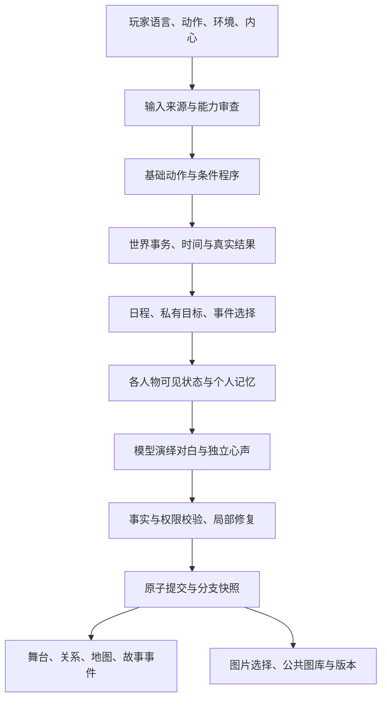

# Yukino 0.9：架构与技术报告

更新日期：2026-10-12。由2026-10-08的38项报告扩展为57项，覆盖用户提出的设计、实现位置、领域先例、实际解法及限制。公开版本经用户明确要求改为Yukino 0.9；内部运行时仍是5.7.10-world-trial。

**当前世界模式已列装，不再沿用旧报告“全部为隔离实验”的状态。** 沙盒和世界保持界限；存档继承压缩与四层记忆原型仍未采用；个人听闻检索是另一个已实现的系统。地图、日程、校历、日常动作、关系和生图入口均补入本报告。

本项目有许多成熟技术的组合与游戏约束，不宣称所有技术首创。模型负责理解、建议和演绎，壳负责状态、时间、许可、对象、分支与执行审核。代码存在、离线通过、真实服务接通和玩家感到世界活着，是四种不同证据。

## 一轮世界模式的运行关系

人物可拒绝、玩家可离开或换方法。世界提供机会，不自动替玩家接任务；后果来自既有条件，不因没走推荐路线而惩罚。重要目标、相遇与后台活动必须有实际结果，不用发送成功掩盖没有进展。

## 技术清单

下列文件均为本版本相对路径，方便其他agent与开发者定位。每项“已实现”表示代码已接入相应模式，不等于在所有剧本、模型和输入上无错误。

### 1. 剧本与壳分离

**设计与解法：** 作者提供世界、人物、地点、物品、开场与玩法；壳提供解析、状态、界面和统一运行接口。导入前校验包格式与引用，避免每新增剧本就修改主程序。

**文件位置：** [skills/sillytavern-roleplay/scripts/worlds.py](skills/sillytavern-roleplay/scripts/worlds.py)；[skills/sillytavern-roleplay/scripts/create_script.py](skills/sillytavern-roleplay/scripts/create_script.py)；[skills/sillytavern-roleplay/scripts/engine_v5.py](skills/sillytavern-roleplay/scripts/engine_v5.py)。

**领域情况：** 角色卡/lorebook 与叙事运行时已有成熟先例；本项目把它们组合为可导入的完整游戏剧本。[SillyTavern World Info](https://docs.sillytavern.app/usage/core-concepts/worldinfo/)和[ink](https://github.com/inkle/ink)提供可比较的内容组织方式。

**当前状态与边界：** 已实现；不是任意外部包都可直接运行，须满足当前 schema 和能力接口。

### 2. 剧本自带玩法模块

**设计与解法：** 剧本可携带委托等专用玩法，壳统一调用 initialize/context/view/action/world_evaluate 等入口，审核模块建议的效果。规则代码经过 AST 限制并在子进程内限时执行。

**文件位置：** [skills/sillytavern-roleplay/scripts/gameplay.py](skills/sillytavern-roleplay/scripts/gameplay.py)；[skills/sillytavern-roleplay/scripts/gameplay_worker.py](skills/sillytavern-roleplay/scripts/gameplay_worker.py)；[skills/sillytavern-roleplay/scripts/engine_v5.py](skills/sillytavern-roleplay/scripts/engine_v5.py)。

**领域情况：** 数据驱动游戏与脚本钩子并非新概念；这里着重解决 AI 剧本的效果审核与分支冻结。

**当前状态与边界：** 已实现；受限 Python 工作者不是针对所有恶意代码的通用安全沙箱。

### 3. 冻结人设、剧本、模块和时间规则

**设计与解法：** 新档保存剧本和主角快照、模块哈希及时间规则。后来改作者文件不会偷偷修改旧档；兼容变化需要显式迁移或新分支。

**文件位置：** [skills/sillytavern-roleplay/scripts/worlds.py](skills/sillytavern-roleplay/scripts/worlds.py)；[skills/sillytavern-roleplay/scripts/gameplay.py](skills/sillytavern-roleplay/scripts/gameplay.py)；[skills/sillytavern-roleplay/scripts/branch_store.py](skills/sillytavern-roleplay/scripts/branch_store.py)；[skills/sillytavern-roleplay/scripts/story_time.py](skills/sillytavern-roleplay/scripts/story_time.py)。

**领域情况：** 版本化内容、快照和可重放状态属于成熟工程方法；本项目用来保护玩家既有经历。

**当前状态与边界：** 已实现；不保证未知历史格式可以自动无损迁移。

### 4. Skills 与实际游戏运行时的分工

**设计与解法：** 技能是创作、导入和维护说明；Python 服务实际运行网页和游戏，DeepSeek 处理文本。固定分镜可本地播放，新图片另外选择后端。

**文件位置：** [skills/sillytavern-roleplay/scripts/galgame.py](skills/sillytavern-roleplay/scripts/galgame.py)；[skills/sillytavern-roleplay/scripts/deepseek_client.py](skills/sillytavern-roleplay/scripts/deepseek_client.py)；[skills/sillytavern-roleplay/scripts/image_service.py](skills/sillytavern-roleplay/scripts/image_service.py)。

**领域情况：** 工具规范、客户端与模型服务分离是通用 agent 应用结构，不应把 skill 当作每回合必须运行的模型。

**当前状态与边界：** 0.9已有独立图片 API；Codex 原生图片仍依赖该账号能力，推荐用技能管理内容。

### 5. 静态人物、玩家简介与可替换主角

**设计与解法：** 静态定义保存身份、性格、外貌和背景；图鉴展示简短资料，模型读取更完整设定。选择主角后冻结自己的设定，不继承八幡以外身份的默认关系。

**文件位置：** [skills/sillytavern-roleplay/scripts/profile_catalog.py](skills/sillytavern-roleplay/scripts/profile_catalog.py)；[skills/sillytavern-roleplay/scripts/cast.py](skills/sillytavern-roleplay/scripts/cast.py)；[skills/sillytavern-roleplay/scripts/tavern.py](skills/sillytavern-roleplay/scripts/tavern.py)。

**领域情况：** 人物卡在角色扮演应用中已普遍存在；本项目加上展示资料与模型资料分离及身份绑定。

**当前状态与边界：** 已实现；缺失的原著资料不应由模型猜成事实。

### 6. 语言、动作、环境、内心输入通道

**设计与解法：** 同一消息可混合四种输入。壳区分说出口的句子、执行的行为、可见环境与未说出的想法，避免把询问当成完成动作。

**文件位置：** [skills/sillytavern-roleplay/scripts/turn_format.py](skills/sillytavern-roleplay/scripts/turn_format.py)；[skills/sillytavern-roleplay/scripts/input_program.py](skills/sillytavern-roleplay/scripts/input_program.py)；[skills/sillytavern-roleplay/scripts/input_grounding.py](skills/sillytavern-roleplay/scripts/input_grounding.py)。

**领域情况：** 输入分类是成熟交互手段；此处同时服务时间结算、角色可见性与自由行动审查。

**当前状态与边界：** 已实现；标记不是语义理解的替代物，复合句仍可能解析失败。

### 7. 按人物投影视野、听觉和知识

**设计与解法：** 为每个人物建立独立 actor_view，仅注入本人可见卡、听到的话及有来源的记忆。导演信息、玩家内心和其他人的秘密不直接喂给人物。

**文件位置：** [skills/sillytavern-roleplay/scripts/perception.py](skills/sillytavern-roleplay/scripts/perception.py)；[skills/sillytavern-roleplay/scripts/actor_context.py](skills/sillytavern-roleplay/scripts/actor_context.py)；[skills/sillytavern-roleplay/scripts/world_turn.py](skills/sillytavern-roleplay/scripts/world_turn.py)。

**领域情况：** agent 的观察与记忆已有[Generative Agents](https://arxiv.org/abs/2304.03442)等研究；我们的着重点是游戏内的知识权限过滤。

**当前状态与边界：** 世界模式已接入；不能声称模型绝不猜中秘密，仍有生成后校验与未知信息边界。

### 8. 认识、熟悉与好感分别记录

**设计与解法：** 第一次见面、眼熟、已知姓名与交流历史不能由好感分数代替。熟悉程度显示独立分数；个人事实必须有获知来源。

**文件位置：** [skills/sillytavern-roleplay/scripts/recognition.py](skills/sillytavern-roleplay/scripts/recognition.py)；[skills/sillytavern-roleplay/scripts/world_state.py](skills/sillytavern-roleplay/scripts/world_state.py)。

**领域情况：** 游戏关系数值很常见；这里解决 LLM 把角色资料误当成双方已相识的问题。

**当前状态与边界：** 已实现；数值高不自动授予姓名、秘密或过去经历。

### 9. 多人交流与真实听众

**设计与解法：** 语言绑定在场位置和真实听者，人物可以旁听、沉默、互相接话。自语不默认发送给上一位发言人，离场者不继续参与当前对话。

**文件位置：** [skills/sillytavern-roleplay/scripts/cast.py](skills/sillytavern-roleplay/scripts/cast.py)；[skills/sillytavern-roleplay/scripts/dialogue_state.py](skills/sillytavern-roleplay/scripts/dialogue_state.py)；[skills/sillytavern-roleplay/scripts/world_turn.py](skills/sillytavern-roleplay/scripts/world_turn.py)。

**领域情况：** 多 agent 交互已有研究先例；本项目额外要求说话、听闻和知识写入互相对应。

**当前状态与边界：** 已实现；模型回应频率和多人场景成本仍取决于当轮状态。

### 10. 有向 n×n 关系图

**设计与解法：** A对B与B对A分别记录好感、信任和熟悉度。人物按自己的性格、处境和请求决定接受、拒绝或透露目标，分数不等于服从。

**文件位置：** [skills/sillytavern-roleplay/scripts/relationship_graph.py](skills/sillytavern-roleplay/scripts/relationship_graph.py)；[skills/sillytavern-roleplay/scripts/relation_policy.py](skills/sillytavern-roleplay/scripts/relation_policy.py)；[skills/sillytavern-roleplay/scripts/affinity.py](skills/sillytavern-roleplay/scripts/affinity.py)。

**领域情况：** 关系图与社会模拟并不罕见；本项目把它用于独立人物请求与目标披露。

**当前状态与边界：** 已接入世界模式；玩家界面显示主角相关投影，不默认公开所有私有态度。

### 11. 回溯创建独立分支

**设计与解法：** 回溯从真实节点快照创建新 session_id，只继承节点以前的经历；父档、兄弟分支及原图保留。历史前缀校验阻止未来记忆误继承。

**文件位置：** [skills/sillytavern-roleplay/scripts/branch_store.py](skills/sillytavern-roleplay/scripts/branch_store.py)；[skills/sillytavern-roleplay/scripts/galgame.py](skills/sillytavern-roleplay/scripts/galgame.py)。

**领域情况：** 存档树与快照是成熟游戏技术；这里还隔离模型摘要、知识与图片引用。

**当前状态与边界：** 已实现；缺失的真实快照不能由模型重构为确定历史。

### 12. 统一存档管理与回收恢复

**设计与解法：** 支持名称、备注、搜索、导入导出、回收与恢复；管理作用于准确存档及选定范围，删除流程包含相关任务文件，避免 UI 消失但输入仍残留。

**文件位置：** [skills/sillytavern-roleplay/scripts/save_manager.py](skills/sillytavern-roleplay/scripts/save_manager.py)；[skills/sillytavern-roleplay/scripts/branch_store.py](skills/sillytavern-roleplay/scripts/branch_store.py)。

**领域情况：** 回收站和事务式管理是常见软件能力，AI 游戏还须处理提示词与原始任务文件。

**当前状态与边界：** 已实现；动态图片迁移需相应素材库，凭据不进入存档包。

### 13. 心声、回看、脉络和事件阅读分离

**设计与解法：** 口语与私有独白分通道。心声只进入独立窗口；故事事件不混入生成诊断。标题、地点用玩家可读名字，事件页只读取当前分支。

**文件位置：** [skills/sillytavern-roleplay/scripts/speech_channels.py](skills/sillytavern-roleplay/scripts/speech_channels.py)；[skills/sillytavern-roleplay/scripts/story_history.py](skills/sillytavern-roleplay/scripts/story_history.py)；[skills/sillytavern-roleplay/scripts/actor_context.py](skills/sillytavern-roleplay/scripts/actor_context.py)；[skills/sillytavern-roleplay/scripts/world_presentation.py](skills/sillytavern-roleplay/scripts/world_presentation.py)。

**领域情况：** 视觉小说分镜与读者视图已有成熟做法；本项目解决生成输出与结构化状态的通道污染。

**当前状态与边界：** 已实现；玩家读世界事件不等于主角获知。旧独白只对明确可识别内容做只读兼容。

### 14. 原文、摘要与预算组成的正式记忆

**设计与解法：** 保留原始历史，组合最近对话、不可变摘要和检索摘录，并验证摘要覆盖的历史前缀。按场景和预算控制注入，结构化状态不由摘要重算。

**文件位置：** [skills/sillytavern-roleplay/scripts/long_memory.py](skills/sillytavern-roleplay/scripts/long_memory.py)；[skills/sillytavern-roleplay/scripts/model_context.py](skills/sillytavern-roleplay/scripts/model_context.py)；[skills/sillytavern-roleplay/scripts/branch_store.py](skills/sillytavern-roleplay/scripts/branch_store.py)。

**领域情况：** 检索与压缩是[上下文工程](https://www.anthropic.com/engineering/effective-context-engineering-for-ai-agents)常用方法；游戏还需要分支、人物和时间限制。

**当前状态与边界：** 已采用这一管线；没有因为窗口较大就每轮填满，也没有默认启用向量数据库。

### 15. 存档继承式上下文压缩原型

**设计与解法：** 曾尝试封存阶段并继承必要状态，以减少重复阅读；实验没有提供足够压缩收益，原系统保留。

**文件位置：** [skills/sillytavern-roleplay/scripts/long_memory.py](skills/sillytavern-roleplay/scripts/long_memory.py)。

**领域情况：** 阶段快照适合状态继承，但省 token 是否明显必须测量；不是结构换名就自然有效。

**当前状态与边界：** 历史原型未采用，不能把它写成0.9默认生效功能。

### 16. 四层记忆原型及权限失败

**设计与解法：** 工作、短期、长期、冷归档曾独立实验，出现人物权限泄漏，未以节省输入为理由列装；后续个人听闻检索另行实现。

**文件位置：** [skills/sillytavern-roleplay/scripts/long_memory.py](skills/sillytavern-roleplay/scripts/long_memory.py)；[skills/sillytavern-roleplay/scripts/world_memory.py](skills/sillytavern-roleplay/scripts/world_memory.py)。

**领域情况：** 分层记忆是已有 agent 方法，权限、来源与恢复质量同样重要。

**当前状态与边界：** 原型未采用；现有 world_memory 不是这套未通过实验的整套实现。

### 17. 时间由壳结算，时代规则随剧本冻结

**设计与解法：** 作者填写开始日期或阶段、时刻、时代和耗时配置。阅读、生图和现实等待不推进故事时间，行动消耗由壳审核；已登记的时代知识与特殊来源受规则限制。

**文件位置：** [skills/sillytavern-roleplay/scripts/story_time.py](skills/sillytavern-roleplay/scripts/story_time.py)；[skills/sillytavern-roleplay/scripts/world_state.py](skills/sillytavern-roleplay/scripts/world_state.py)。

**领域情况：** 游戏时钟和时代约束本身是成熟设计；本项目避免让模型任意改日期。

**当前状态与边界：** 已实现；不能硬判所有未登记自由文本是否含时代知识，不能承诺穷尽1800年后的常识。

### 18. 文字与图片两条独立管道

**设计与解法：** 文本保持用户配置的 DeepSeek，图片使用独立 Codex 或兼容图片 API。生图环境和凭据不改变文本模型，已有画面可继续使用。

**文件位置：** [skills/sillytavern-roleplay/scripts/deepseek_client.py](skills/sillytavern-roleplay/scripts/deepseek_client.py)；[skills/sillytavern-roleplay/scripts/image_service.py](skills/sillytavern-roleplay/scripts/image_service.py)；[skills/sillytavern-roleplay/scripts/image_backends.py](skills/sillytavern-roleplay/scripts/image_backends.py)。

**领域情况：** agent 调用专用工具是通用分工；图片模型不是文本模型增加一个提示词就能替代。

**当前状态与边界：** 已实现；切换图片供应商是显式配置，不会失败后偷偷回退。

### 19. 稳定提示前缀与实际缓存指标

**设计与解法：** 把稳定人设、阶段协议与动态状态按固定次序组织；计量实际请求、修复次数和缓存命中/未命中，而不是只统计最后成功调用。

**文件位置：** [skills/sillytavern-roleplay/scripts/prompt_cache.py](skills/sillytavern-roleplay/scripts/prompt_cache.py)；[skills/sillytavern-roleplay/scripts/model_context.py](skills/sillytavern-roleplay/scripts/model_context.py)；[skills/sillytavern-roleplay/scripts/deepseek_client.py](skills/sillytavern-roleplay/scripts/deepseek_client.py)。

**领域情况：** 前缀缓存是服务端常见优化；本项目在保持人物权限与当轮状态正确的前提下组织输入。

**当前状态与边界：** 已实现；状态变化和局部重试仍会产生缓存未命中，不能保证固定命中率。

### 20. 幂等请求与原子提交

**设计与解法：** request_id、turn_id、revision 与原子替换共同防止重复提交或错档写入。先审核实际执行结果，再同时提交故事与结构化变化。

**文件位置：** [skills/sillytavern-roleplay/scripts/tavern.py](skills/sillytavern-roleplay/scripts/tavern.py)；[skills/sillytavern-roleplay/scripts/galgame.py](skills/sillytavern-roleplay/scripts/galgame.py)；[skills/sillytavern-roleplay/scripts/branch_store.py](skills/sillytavern-roleplay/scripts/branch_store.py)。

**领域情况：** 幂等、乐观并发和事务属于成熟后端技术；这里绑定到玩家一轮行动。

**当前状态与边界：** 已实现；发送成功不等于目标达成，网络结果不确定须恢复核对。

### 21. 剧本公共图库与分支独立引用

**设计与解法：** 同剧本优先寻找匹配背景/交流画面；实际采用的素材反哺公共候选，分支只解锁自己采用的引用，立绘不混入公共背景库。

**文件位置：** [skills/sillytavern-roleplay/scripts/shared_gallery.py](skills/sillytavern-roleplay/scripts/shared_gallery.py)；[skills/sillytavern-roleplay/scripts/runtime_v4.py](skills/sillytavern-roleplay/scripts/runtime_v4.py)。

**领域情况：** 缓存、内容寻址和资源复用是成熟方法；游戏还需要防止未来画面泄漏和错误身份匹配。

**当前状态与边界：** 已实现；匹配依赖地点、画面身份与事件约束，不仅比较提示词相似度。

### 22. 有限预测图库与真实采用释放名额

**设计与解法：** 每棵故事树共用背景2、立绘3、交流画面1的候选名额。只有实际采用才释放额度；失败或未使用候选不无限轮换。

**文件位置：** [skills/sillytavern-roleplay/scripts/preview_library.py](skills/sillytavern-roleplay/scripts/preview_library.py)；[skills/sillytavern-roleplay/scripts/runtime_v4.py](skills/sillytavern-roleplay/scripts/runtime_v4.py)。

**领域情况：** 资源预加载与有界队列是成熟游戏工程方法。

**当前状态与边界：** 已实现；预测不成为事实、不自动换场景，缺少剧情依据时允许空缺。

### 23. CG就绪门控与准确素材身份

**设计与解法：** 插图绑定真实回合和素材键；就绪前可等待或继续故事，迟到图不打断其他节点。人物离场才隐藏，旁白不借用别人的脸。

**文件位置：** [skills/sillytavern-roleplay/scripts/story_history.py](skills/sillytavern-roleplay/scripts/story_history.py)；[skills/sillytavern-roleplay/scripts/cast.py](skills/sillytavern-roleplay/scripts/cast.py)；[skills/sillytavern-roleplay/scripts/runtime_v4.py](skills/sillytavern-roleplay/scripts/runtime_v4.py)。

**领域情况：** 视觉小说播放门控与异步解码很常见；本项目额外处理动态生成延迟。

**当前状态与边界：** 已实现；真正可加载的图片才算成功，模型声称生成不能作证。

### 24. 提示词重画与独立图片版本

**设计与解法：** 补充画面要求，以原图与人物参考生成新版；保留故事事实、身份和原文件，新旧对比后由玩家采用，只修改当前分支的选择。

**文件位置：** [skills/sillytavern-roleplay/scripts/image_adjustments.py](skills/sillytavern-roleplay/scripts/image_adjustments.py)；[skills/sillytavern-roleplay/scripts/shared_gallery.py](skills/sillytavern-roleplay/scripts/shared_gallery.py)；[skills/sillytavern-roleplay/scripts/runtime_v4.py](skills/sillytavern-roleplay/scripts/runtime_v4.py)。

**领域情况：** 图像编辑及版本管理已有成熟工具；本项目把选择绑定到回溯节点。

**当前状态与边界：** 已实现；图片 API需支持参考图编辑，不能为了接通而把重画退化为无参考文生图。

### 25. 强目标主线与自由过程的预制故事

**设计与解法：** 预制阶段固定关键问题、边界和收束条件，提供预设方法和自拟行动；不限制自由互动次数，达标后汇合，不替玩家选择接受任务。

**文件位置：** [skills/sillytavern-roleplay/scripts/authored_story.py](skills/sillytavern-roleplay/scripts/authored_story.py)；[skills/sillytavern-roleplay/scripts/world_authored.py](skills/sillytavern-roleplay/scripts/world_authored.py)。

**领域情况：** [ink](https://github.com/inkle/ink)等已有分支叙事；我们的组合加入模型自由阶段与状态证据收束。

**当前状态与边界：** 已实现短篇框架与春物终卷原创改编；不是原著逐字复刻。

### 26. 任务、约定、物品与剧情阶段

**设计与解法：** 物品归属、委托进度、期限、承诺与阶段目标进入状态。故事描述不能自行发放物品、完成任务或更改模块进度。

**文件位置：** [skills/sillytavern-roleplay/scripts/story_engine.py](skills/sillytavern-roleplay/scripts/story_engine.py)；[skills/sillytavern-roleplay/scripts/world_modules.py](skills/sillytavern-roleplay/scripts/world_modules.py)；[skills/sillytavern-roleplay/scripts/world_state.py](skills/sillytavern-roleplay/scripts/world_state.py)。

**领域情况：** 任务状态机是成熟游戏结构；这里用于约束生成叙述。

**当前状态与边界：** 已实现；特殊任务仍需作者明确提供完成条件。

### 27. 动态世界以事件卡表达

**设计与解法：** 位置、目标、知识、情绪、日程与关系进入世界卡状态，静态性格和背景保留在人设。每张动态记录标明对象、来源、可见性和当前值。

**文件位置：** [skills/sillytavern-roleplay/scripts/event_schema.py](skills/sillytavern-roleplay/scripts/event_schema.py)；[skills/sillytavern-roleplay/scripts/world_state.py](skills/sillytavern-roleplay/scripts/world_state.py)。

**领域情况：** 事实状态与事件驱动属于已有架构；这里将它们用作人物可见上下文和执行证据。

**当前状态与边界：** 世界模式已列装；并未把所有任意自然语言都转成可证明的形式逻辑。

### 28. 基础卡与可复用组合标准库

**设计与解法：** 壳内定义移动、观察、拿取、阅读、说话等最小动作与校验。复合方案由基础动作组成，可复用但不能随模型造词获得新执行权限。

**文件位置：** [skills/sillytavern-roleplay/scripts/basic_cards.py](skills/sillytavern-roleplay/scripts/basic_cards.py)；[skills/sillytavern-roleplay/scripts/action_methods.py](skills/sillytavern-roleplay/scripts/action_methods.py)。

**领域情况：** 动作原语与规划算子是成熟方法；本项目使它们服务自由输入而非固定按钮玩法。

**当前状态与边界：** 已实现；动态注册需要落回受审核原语，不接受未知代码直接执行。

### 29. 物品格式、通用行为与具体内容分离

**设计与解法：** 通用持有、交接、消耗、阅读等规则由壳提供；具体书、信、资料及内容由剧本或合法运行事件构建。权限允许玩家授权NPC阅读自己的物品。

**文件位置：** [skills/sillytavern-roleplay/scripts/item_rules.py](skills/sillytavern-roleplay/scripts/item_rules.py)；[skills/sillytavern-roleplay/scripts/read_permissions.py](skills/sillytavern-roleplay/scripts/read_permissions.py)；[skills/sillytavern-roleplay/scripts/world_state.py](skills/sillytavern-roleplay/scripts/world_state.py)。

**领域情况：** 游戏物品系统是成熟技术；AI场景更需要明确内容与知识何时转移。

**当前状态与边界：** 已实现；取得物品不等于已读内容，不凭玩家一句自述造出成功历史。

### 30. 自由输入解析、条件和语言动作检测

**设计与解法：** 把玩家原文解析为有来源的步骤，区分请求、计划、条件与即时动作；检测口语中的下一步意图，但人物自己的行为仍由本人和规则审核。

**文件位置：** [skills/sillytavern-roleplay/scripts/input_program.py](skills/sillytavern-roleplay/scripts/input_program.py)；[skills/sillytavern-roleplay/scripts/language_actions.py](skills/sillytavern-roleplay/scripts/language_actions.py)；[skills/sillytavern-roleplay/scripts/input_grounding.py](skills/sillytavern-roleplay/scripts/input_grounding.py)。

**领域情况：** 工具调用与动作规划已有先例；本项目额外检查输入来源和主角控制权。

**当前状态与边界：** 已实现；模型仍可能误拆，条件未成立不能提前执行后续步骤。

### 31. 世界事务与可核对历史包

**设计与解法：** 在复制的事务状态执行、结算、审核，生成含前后状态摘要与事件的回合包，再提交快照；原分支不被失败草稿污染。

**文件位置：** [skills/sillytavern-roleplay/scripts/world_heartbeat.py](skills/sillytavern-roleplay/scripts/world_heartbeat.py)；[skills/sillytavern-roleplay/scripts/world_state.py](skills/sillytavern-roleplay/scripts/world_state.py)；[skills/sillytavern-roleplay/scripts/inspect_world.py](skills/sillytavern-roleplay/scripts/inspect_world.py)。

**领域情况：** 事件记录和事务快照是成熟工程方法。

**当前状态与边界：** 已实现；实际完成须核对状态与证据，不能只看接口返回200。

### 32. 有界世界心跳与事件选择

**设计与解法：** 故事时间或状态变化唤醒相关规则、目标和机会；选择器按条件、优先级、概率和总工作量推进人物活动。拒绝机会和绕路仍保留内容。

**文件位置：** [skills/sillytavern-roleplay/scripts/event_rules.py](skills/sillytavern-roleplay/scripts/event_rules.py)；[skills/sillytavern-roleplay/scripts/world_heartbeat.py](skills/sillytavern-roleplay/scripts/world_heartbeat.py)；[skills/sillytavern-roleplay/scripts/world_activity.py](skills/sillytavern-roleplay/scripts/world_activity.py)。

**领域情况：** 事件驱动模拟及[Generative Agents](https://arxiv.org/abs/2304.03442)的社会行为可作参照；不是心跳定时器本身带来生命感。

**当前状态与边界：** 已列装；后台活动密度与长空白期仍有限，不声称完整连续模拟整个世界。

### 33. 沙盒/世界模式界限与目标卡集接口

**设计与解法：** 新档选择模式并冻结：沙盒保持自由叙述，世界使用受审核事件执行。剧本可提供目标卡集，壳保留模型建议目标的接口。

**文件位置：** [skills/sillytavern-roleplay/scripts/world_modes.py](skills/sillytavern-roleplay/scripts/world_modes.py)；[skills/sillytavern-roleplay/scripts/goal_sets.py](skills/sillytavern-roleplay/scripts/goal_sets.py)。

**领域情况：** 多模式与可替换规划器是常见应用架构。

**当前状态与边界：** 已实现；旧档不随界面开关换模式，不自动把人物所有目标公开给主角。

### 34. 多种行动拆解与持久方案库

**设计与解法：** 首次目标拆解形成可核查方法，后续验证是否符合实际需求；同目标不同方案独立保存，受阻后可以选其他方案，不反复覆盖先前拆解。

**文件位置：** [skills/sillytavern-roleplay/scripts/action_methods.py](skills/sillytavern-roleplay/scripts/action_methods.py)；[skills/sillytavern-roleplay/scripts/goal_planner.py](skills/sillytavern-roleplay/scripts/goal_planner.py)；[skills/sillytavern-roleplay/scripts/goal_feedback.py](skills/sillytavern-roleplay/scripts/goal_feedback.py)。

**领域情况：** 规划、方法复用和失败后调整已有 agent 研究；本项目要求每一步有合法世界对象。

**当前状态与边界：** 已列装；方案存在不代表目标必定能完成，依赖前置许可、资源和路线。

### 35. 目标动机、期限与重要后台结算

**设计与解法：** 用目标价值、受阻和时间检查减少无效循环；重要后台目标仅在完成条件和代价可核对时结算，不用旁白替代取得、许可或精神/物质成本。

**文件位置：** [skills/sillytavern-roleplay/scripts/goal_motivation.py](skills/sillytavern-roleplay/scripts/goal_motivation.py)；[skills/sillytavern-roleplay/scripts/goal_planner.py](skills/sillytavern-roleplay/scripts/goal_planner.py)；[skills/sillytavern-roleplay/scripts/world_heartbeat.py](skills/sillytavern-roleplay/scripts/world_heartbeat.py)。

**领域情况：** 目标权重与规划代价是成熟思路；生成模型提供评估建议，程序保留审核权。

**当前状态与边界：** 已列装；不能为验收而强行把所有目标判成功。

### 36. 私有目标与关系门控披露

**设计与解法：** 目标默认仅本人可见。询问后本人按好感、熟悉、信任、处境与性格决定透露；真的说出口才向真实听者写入对应知识。

**文件位置：** [skills/sillytavern-roleplay/scripts/goal_disclosure.py](skills/sillytavern-roleplay/scripts/goal_disclosure.py)；[skills/sillytavern-roleplay/scripts/relationship_graph.py](skills/sillytavern-roleplay/scripts/relationship_graph.py)；[skills/sillytavern-roleplay/scripts/card_refinement.py](skills/sillytavern-roleplay/scripts/card_refinement.py)。

**领域情况：** 权限化记忆与社交门控均有先例；本项目把它们落实为请求上下文过滤和状态写入。

**当前状态与边界：** 已列装；高好感不意味着必须吐露心声，拒绝不会自动泄漏目标摘要。

### 37. 硬执行、语义审查与事实账本

**设计与解法：** 代码判定路线、对象、能力和状态；模型标记不合理之处，规则决定通过、重写或拒绝。旁白与对白须匹配已执行结果，诊断在工作记录中单独保存。

**文件位置：** [skills/sillytavern-roleplay/scripts/card_validation.py](skills/sillytavern-roleplay/scripts/card_validation.py)；[skills/sillytavern-roleplay/scripts/fact_ledger.py](skills/sillytavern-roleplay/scripts/fact_ledger.py)；[skills/sillytavern-roleplay/scripts/diagnostic_system.py](skills/sillytavern-roleplay/scripts/diagnostic_system.py)；[skills/sillytavern-roleplay/scripts/action_guard.py](skills/sillytavern-roleplay/scripts/action_guard.py)。

**领域情况：** 结构化工具协议与验证循环已有成熟 agent 实现；这里加上人物与游戏状态约束。

**当前状态与边界：** 已列装；验证模型也会犯错，不可宣称自然语言一致性已完全硬证明。

### 38. 世界有效活动的验收标准

**设计与解法：** 验收检查是否移动、取得对象、完成目标、合理拒绝和留下后果；记录失败及对应代码，不能用“提交成功”掩盖世界没有进展。

**文件位置：** [skills/sillytavern-roleplay/scripts/inspect_world.py](skills/sillytavern-roleplay/scripts/inspect_world.py)；[skills/sillytavern-roleplay/scripts/diagnostic_system.py](skills/sillytavern-roleplay/scripts/diagnostic_system.py)；[skills/sillytavern-roleplay/scripts/world_presentation.py](skills/sillytavern-roleplay/scripts/world_presentation.py)。

**领域情况：** agent评估强调实际任务结果，游戏还需玩家可感知的状态和叙事。

**当前状态与边界：** 持续使用这一标准；离线模拟通过不等于所有真实模型回合通过。

### 39. 小空间必然可观察的到场

**设计与解法：** 同一小活动室真实到场必须有旁白或可观察提示，不强迫对话；大区域不因同location ID就必定相遇，门外与房内分别判定。

**文件位置：** [skills/sillytavern-roleplay/scripts/room_presence.py](skills/sillytavern-roleplay/scripts/room_presence.py)；[skills/sillytavern-roleplay/scripts/world_heartbeat.py](skills/sillytavern-roleplay/scripts/world_heartbeat.py)；[skills/sillytavern-roleplay/scripts/card_refinement.py](skills/sillytavern-roleplay/scripts/card_refinement.py)。

**领域情况：** 空间可见性是成熟游戏方法；本项目修正调度已到场而故事没有人的断层。

**当前状态与边界：** 已实现；未知姓名仍用可见身份描写，避免借提示提前暴露。

### 40. 有限父子地图与受控地点探索

**设计与解法：** 剧本定义父地点和边界，壳限制层级、总节点、子地点生成与路线；首次提到未知地点不默认瞬移到无限地图。地图入口展示主角已知空间。

**文件位置：** [skills/sillytavern-roleplay/scripts/map_schema.py](skills/sillytavern-roleplay/scripts/map_schema.py)；[skills/sillytavern-roleplay/scripts/map_runtime.py](skills/sillytavern-roleplay/scripts/map_runtime.py)；[skills/sillytavern-roleplay/scripts/map_exploration.py](skills/sillytavern-roleplay/scripts/map_exploration.py)；[skills/sillytavern-roleplay/scripts/map_references.py](skills/sillytavern-roleplay/scripts/map_references.py)。

**领域情况：** 层级场景图和路径图是成熟游戏技术；本项目把模型提议纳入有界结构。

**当前状态与边界：** 已实现；发现路线、看见门口和获知房间用途不是同一件事。

### 41. 人物日程与自主目标

**设计与解法：** 日程提供某时段的倾向与目标，人物按路线、现有状态和自己的决定活动；安排冲突、错过和实际执行分别记录，玩家不控制NPC执行表。

**文件位置：** [skills/sillytavern-roleplay/scripts/npc_schedule.py](skills/sillytavern-roleplay/scripts/npc_schedule.py)；[skills/sillytavern-roleplay/scripts/schedule_runtime.py](skills/sillytavern-roleplay/scripts/schedule_runtime.py)；[skills/sillytavern-roleplay/scripts/goal_sets.py](skills/sillytavern-roleplay/scripts/goal_sets.py)。

**领域情况：** [Generative Agents](https://arxiv.org/abs/2304.03442)展示过日常规划；我们的日程还受分支状态和私有知识约束。

**当前状态与边界：** 已实现；空白时段生活密度仍有限，missed计划不等于已证实缺勤。

### 42. 课表、考勤、节假日与下课窗口

**设计与解法：** 课程按真实教室、上课日和节假日生成公开安排；迟到可参与剩余课程，固定下课时间不被重新起算。老师只依据点名与目击知道缺勤。

**文件位置：** [skills/sillytavern-roleplay/scripts/school_calendar.py](skills/sillytavern-roleplay/scripts/school_calendar.py)；[skills/sillytavern-roleplay/scripts/schedule_runtime.py](skills/sillytavern-roleplay/scripts/schedule_runtime.py)；[skills/sillytavern-roleplay/scripts/npc_schedule.py](skills/sillytavern-roleplay/scripts/npc_schedule.py)。

**领域情况：** 日历和时间窗调度属于成熟模拟方法；AI生成不能自拟等待上限或考勤历史。

**当前状态与边界：** 已实现；春物具体排期含游戏推断和原创补写，不当作原作精确日历。

### 43. 公共预期事件与人物自主参加

**设计与解法：** 事件入口提供主角、世界、预期事件三页；只有明确公开的排期进入学生与老师的可知信息。NPC考虑目标、日程和关系后决定参加，邀请不等于答应。

**文件位置：** [skills/sillytavern-roleplay/scripts/school_calendar.py](skills/sillytavern-roleplay/scripts/school_calendar.py)；[skills/sillytavern-roleplay/scripts/fixed_events.py](skills/sillytavern-roleplay/scripts/fixed_events.py)；[skills/sillytavern-roleplay/scripts/actor_context.py](skills/sillytavern-roleplay/scripts/actor_context.py)。

**领域情况：** 公开日历与社交模拟已有先例；本项目分开预期、意向、目标与实际在场。

**当前状态与边界：** 已实现；名单不是强制搬运人物的指令，私有目标不出现在公共预期表。

### 44. 日常细节轻量结算

**设计与解法：** 点头、整理衣领等不需要繁重对象手续；购买、持有和交接仍保留必要状态。可简化过程，不能旁白说已买到、下一轮又没有物品。

**文件位置：** [skills/sillytavern-roleplay/scripts/daily_life.py](skills/sillytavern-roleplay/scripts/daily_life.py)；[skills/sillytavern-roleplay/scripts/item_rules.py](skills/sillytavern-roleplay/scripts/item_rules.py)；[skills/sillytavern-roleplay/scripts/world_state.py](skills/sillytavern-roleplay/scripts/world_state.py)。

**领域情况：** 模拟精度分级是常见游戏工程取舍。

**当前状态与边界：** 已实现；轻量记录不等于允许生成未经结算的世界事实。

### 45. 关系增长来源、重复限制与共同经历

**设计与解法：** 关系改变记录原因和每日/重复互动限制；自由完成的共同经历也可推进，达到数值上限后仍按人物性格回应。

**文件位置：** [skills/sillytavern-roleplay/scripts/relation_policy.py](skills/sillytavern-roleplay/scripts/relation_policy.py)；[skills/sillytavern-roleplay/scripts/relationship_graph.py](skills/sillytavern-roleplay/scripts/relationship_graph.py)。

**领域情况：** 成长曲线与防刷分已有游戏先例；本项目不把数值门槛当成自动同意恋爱。

**当前状态与边界：** 已实现；隐私披露门控与恋爱阶段不能混成一个阈值。

### 46. 完整个人与家庭背景的模型资料

**设计与解法：** 人物卡加入家庭、亲属、学校与成长背景及来源；小卡仍简洁，模型读取结构化 personal_background，未知细节保留未确认。

**文件位置：** [skills/sillytavern-roleplay/scripts/profile_catalog.py](skills/sillytavern-roleplay/scripts/profile_catalog.py)；[skills/sillytavern-roleplay/scripts/world_defaults.py](skills/sillytavern-roleplay/scripts/world_defaults.py)；[skills/sillytavern-roleplay/scripts/actor_context.py](skills/sillytavern-roleplay/scripts/actor_context.py)。

**领域情况：** 检索增强角色设定很常见；本项目要求原著资料与已发生故事分开。

**当前状态与边界：** 已实现；二手社区来源不是原作的不可纠正定论。

### 47. 按需个人听闻检索与来源笔记

**设计与解法：** 借鉴上下文工程组织方法，在真实听闻、旧原文和结构化事件中检索，先过滤剧本、分支、故事时间、角色与来源；自述不自动升级为客观事实。

**文件位置：** [skills/sillytavern-roleplay/scripts/world_memory.py](skills/sillytavern-roleplay/scripts/world_memory.py)；[skills/sillytavern-roleplay/scripts/model_context.py](skills/sillytavern-roleplay/scripts/model_context.py)；[skills/sillytavern-roleplay/scripts/actor_context.py](skills/sillytavern-roleplay/scripts/actor_context.py)。

**领域情况：** [Anthropic 上下文工程](https://www.anthropic.com/engineering/effective-context-engineering-for-ai-agents)讨论笔记、检索和压缩；我们的补充是游戏权限约束。

**当前状态与边界：** 已实现；不使用未通过权限实验的分层记忆，不依赖向量库才能运行。

### 48. 结构化输出与阶段局部修复

**设计与解法：** 不同阶段使用固定结构与类型校验，错误按传输、格式、对象定位、权限和事实分开；无损格式整理优先，局部重试有界，不无谓重跑整个回合。

**文件位置：** [skills/sillytavern-roleplay/scripts/model_protocol.py](skills/sillytavern-roleplay/scripts/model_protocol.py)；[skills/sillytavern-roleplay/scripts/diagnostic_system.py](skills/sillytavern-roleplay/scripts/diagnostic_system.py)；[skills/sillytavern-roleplay/scripts/world_turn.py](skills/sillytavern-roleplay/scripts/world_turn.py)。

**领域情况：** agent框架普遍使用工具schema和错误恢复；本项目避免把权限拒绝“修复”为成功。

**当前状态与边界：** 已实现；稳定协议减少格式错误，不保证语义永不错误。

### 49. 执行结果驱动下一步与玩家反馈

**设计与解法：** 模型读取实际已成功、被拒绝、受阻和未执行步骤；独立说明拒绝原因，保留先前成功动作，不能通过安静旁白掩盖无效回合。

**文件位置：** [skills/sillytavern-roleplay/scripts/player_feedback.py](skills/sillytavern-roleplay/scripts/player_feedback.py)；[skills/sillytavern-roleplay/scripts/card_runtime.py](skills/sillytavern-roleplay/scripts/card_runtime.py)；[skills/sillytavern-roleplay/scripts/card_refinement.py](skills/sillytavern-roleplay/scripts/card_refinement.py)。

**领域情况：** 工具结果反馈是成熟 agent 循环；游戏需同时保证叙事和状态对齐。

**当前状态与边界：** 已实现；角色合理沉默与生成失败分别处理，不强制每次都回应。

### 50. 无损快照编码、崩溃锁恢复与隐私回收

**设计与解法：** 重复的大状态以无损方式编码，读取统一解码；失活锁检查归属后恢复；回收与彻底清除覆盖任务输入及关联记录，恢复保留分支关系。

**文件位置：** [skills/sillytavern-roleplay/scripts/storage_codec.py](skills/sillytavern-roleplay/scripts/storage_codec.py)；[skills/sillytavern-roleplay/scripts/process_locks.py](skills/sillytavern-roleplay/scripts/process_locks.py)；[skills/sillytavern-roleplay/scripts/save_manager.py](skills/sillytavern-roleplay/scripts/save_manager.py)。

**领域情况：** 无损编码、锁和生命周期管理是成熟存储方法。

**当前状态与边界：** 已实现；编码不是模型摘要，不允许旧脚本把压缩标记当作状态覆盖。

### 51. 独立启动器与服务身份核对

**设计与解法：** 检测Python、首启引导、只读自检、真实端口复用；线程/进程锁防重复启动；以root/provider/runtime确认服务身份，停止不杀别的库。

**文件位置：** [launcher/setup.py](launcher/setup.py)；[launcher/service_control.py](launcher/service_control.py)；[launcher/bootstrap.ps1](launcher/bootstrap.ps1)。

**领域情况：** 本地应用启动和健康检查是成熟工程方法。

**当前状态与边界：** 已实现；已有游戏保持原进程，配置变化须正常停止再启动。

### 52. 分开的生图方式、密钥和环境状态

**设计与解法：** 已有图、Codex、独立图片API和可灵授权各有独立入口。图片密钥以DPAPI保存并绑定接口，不借用DeepSeek密钥；界面分别标记配置、登录、握手和未试画。

**文件位置：** [skills/sillytavern-roleplay/scripts/image_backends.py](skills/sillytavern-roleplay/scripts/image_backends.py)；[launcher/image_setup.py](launcher/image_setup.py)；[launcher/image-setup.js](launcher/image-setup.js)。

**领域情况：** 工具后端和凭据分离在agent插件中已有实践，例如[dsh-image-generation](https://github.com/ankye/dsh-image-generation)。

**当前状态与边界：** 0.9新增；可灵入口不是已完成的自动生图后端，接口切换不影响故事或替换旧图。

### 53. Codex登录检测与本包工具配置

**设计与解法：** 读取CLI登录退出码，执行原生app-server握手，不展示凭据；固定版本CLI可安装到runtime而不改全局模型配置，官方OAuth由玩家完成。

**文件位置：** [skills/sillytavern-roleplay/scripts/image_service.py](skills/sillytavern-roleplay/scripts/image_service.py)；[launcher/image_setup.py](launcher/image_setup.py)。

**领域情况：** [官方CLI](https://developers.openai.com/codex/cli/reference/)支持登录状态检查和app-server；应用预检不等于一次真实生成。

**当前状态与边界：** 本机已验证登录和握手，未试画；图片能力、账号额度和后续生成仍需实际服务确认。

### 54. 无需Codex的图片API与参考图版本管线

**设计与解法：** 独立实现兼容图片接口：文生图走generations，参考图与重画走edits，返回真实本地文件后接入现有图库。成功缓存复用；提交结果未知时不重提，下载失败只重试下载。

**文件位置：** [skills/sillytavern-roleplay/scripts/image_backends.py](skills/sillytavern-roleplay/scripts/image_backends.py)；[skills/sillytavern-roleplay/scripts/runtime_v4.py](skills/sillytavern-roleplay/scripts/runtime_v4.py)。

**领域情况：** [用户指定插件](https://github.com/ankye/dsh-image-generation/tree/main/packages/tool-image-generation)采用后端与工具分离；本项目用Python接入已有游戏管线并保留参考图和版本要求。

**当前状态与边界：** 本地假服务端到端已验证；未使用真实图片供应商密钥，不保证任意号称兼容的服务都支持编辑/透明图。

### 55. 可灵独立OAuth、实时schema与计费边界

**设计与解法：** 依据[klingai-dev/deepseek-plugin](https://github.com/klingai-dev/deepseek-plugin)提供的标准桥接，单独安装固定版mcp-remote，授权后仅初始化、列工具、读取本人账号。

**文件位置：** [launcher/image_setup.py](launcher/image_setup.py)。

**领域情况：** 原插件已有OAuth和生成后跟踪流程；[MCP授权规范](https://modelcontextprotocol.io/specification/2025-03-26/basic/authorization)提供标准授权机制。

**当前状态与边界：** 授权检测连接器已实现，假OAuth/MCP协议检查通过；没有真实可灵账号验证，自动生成尚未接入，不猜测计费工具参数。

### 56. 公开包的隐私、素材来源与许可隔离

**设计与解法：** 公开库使用独立导入的初始剧本与原创占位图，不从玩家data抽取；剔除凭据、任务记录、私有备份和原作美术；保留代码许可、音乐署名和补图说明。

**文件位置：** [verify.py](verify.py)；[README.md](README.md)。

**领域情况：** 最小发行、隐私白名单与资源授权是常见分发要求，AI生成游戏同样需要。

**当前状态与边界：** 本地带美术测试包和GitHub公共源码包区别明确；公开可下载素材不等于可重分发授权。

### 57. 安装与发布对象的一致性核对

**设计与解法：** 对实际程序、解压包、模块依赖与文件清单核对哈希；隔离新档验证实际接口和资源，保留失败，不让“工作副本通过”替代“已安装对象通过”。

**文件位置：** [verify.py](verify.py)；[manifest.json](manifest.json)。

**领域情况：** 构建清单、可重现检查和测试分层是成熟发布工程方法。

**当前状态与边界：** 本轮新增24项、启动器33项通过；全量399项有两项旧地点断言未通过，1项跳过，不能宣称所有玩法已验证。

## 当前验证证据及尚未完成的工作

本轮新生图测试使用合成密钥、本机假图片服务与假MCP，没有发送玩家存档、没有真实图片生成费用。24项后端/配置检查和33项启动器检查通过；本机Codex账号登录与app-server握手通过，`generation_verified`保持false。可灵尚未用真实账号完成端到端授权或绘图。独立图片API尚无真实供应商试画，不能拿本机测试图片证明画质或人物一致性。

既有完整回归运行399项，2项旧地点断言失败，1项跳过；失败涉及前轮对“前往教室/走进教室”的确定性解析行为，相关解析源码本轮未修改。结果保留，不把它们删除或写成全部通过。历史真实模型实验仍只证明当时版本与对应场景。本轮不进行玩家长档压力测试。

后续重点是人物空白期活动密度、自由输入误解析、已完成事件的叙述真实性与实际角色画面质量。跳日系统没有在这轮偷偷加入。重要后台行动不能以低成本抽象为理由跳过许可、物品取得和真实知识来源。

## 维护原则

1. 改动在最新维护源码完成，再明确同步到独立包或公开副本；不是批量覆盖历史实验。
2. 正式玩家数据与测试数据分开，不能通过改写旧存档让验收通过。
3. 发布只加入明确允许的程序、初始剧本和素材，凭据与私人剧情不提交。
4. 同时记录失败、退化和未验证项；特别区分模型状态建议、程序执行结果与玩家看到的文字。
5. 不把人物自主性、玩家拒绝权和知识权限换成固定动作流程来降低实现难度。

## 本轮界面补充

中文标题与新档祝福彩蛋在[skills/sillytavern-roleplay/assets/galgame/index.html](skills/sillytavern-roleplay/assets/galgame/index.html)、[easter-egg.js](skills/sillytavern-roleplay/assets/galgame/easter-egg.js)及engine-ui.css。仅影响输入页显示，不调用模型、不修改故事状态。完整验证范围见[0.9验证说明](docs/0.9验证说明.md)。
